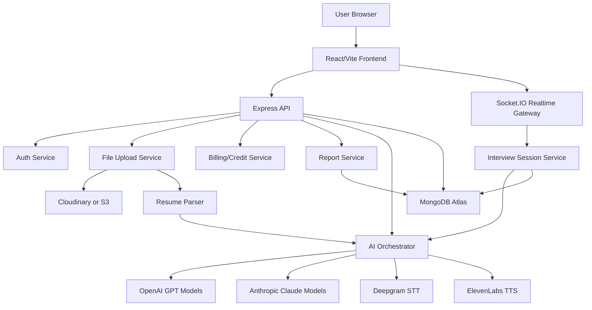
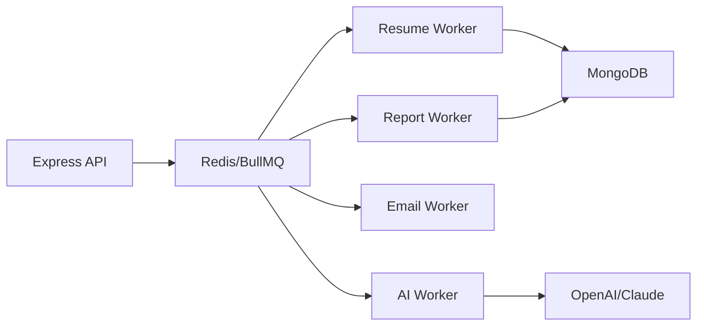

# InterviewIQ Implementation Blueprint

## 1. Product Requirements Document

### Product Summary
InterviewIQ is an AI-powered mock interview SaaS platform for students, freshers, and professionals. Users upload a resume, receive an AI-generated candidate profile, complete realistic voice-based mock interviews, solve one coding problem, and receive detailed scoring, analytics, and improvement plans.

### Primary Users
- Students preparing for campus placements.
- Freshers applying for entry-level jobs.
- Professionals preparing for role changes.
- Training institutes that need scalable interview practice.

### Core Goals
- Simulate realistic interviews through adaptive AI questioning.
- Personalize interviews based on resume, skills, projects, and target role.
- Provide actionable feedback across technical, behavioral, coding, and communication dimensions.
- Track progress over time through analytics and historical reports.

### MVP Scope
- Email/password authentication with JWT.
- Google OAuth.
- Resume upload and AI resume analysis.
- Candidate profile generation.
- Adaptive mock interview flow.
- Text-first interview mode with voice-ready architecture.
- Deepgram STT integration for user speech.
- ElevenLabs TTS integration for AI interviewer voice.
- One coding question per interview with Monaco Editor.
- AI-generated evaluation report.
- Dashboard with charts and interview history.
- Free tier limit of 2 interviews.
- Paid per-interview credit support.

### Post-MVP Scope
- Live code execution sandbox.
- Subscription billing.
- Organization accounts.
- Human coach review.
- Interview templates by company.
- WebRTC low-latency voice sessions.
- Mobile app.

### Key Success Metrics
- Resume analysis completion rate.
- Interview start-to-completion rate.
- Average interviews per active user.
- Paid conversion after free quota.
- Report view rate.
- Improvement in readiness score across repeated interviews.

## 2. System Architecture



### Runtime Components
- Frontend: React, Vite, Tailwind CSS, shadcn/ui, Framer Motion, Recharts, Monaco Editor.
- Backend: Node.js, Express.js, Socket.IO, Mongoose.
- Database: MongoDB Atlas.
- File Storage: Cloudinary for MVP, S3 for larger production deployments.
- AI Providers: OpenAI for structured generation and evaluation, Claude for second-pass reasoning where needed.
- Voice Providers: Deepgram for speech-to-text, ElevenLabs for text-to-speech.
- Deployment: Vercel frontend, Railway/Render backend, MongoDB Atlas database.

## 3. Database Schema

### Main Collections
- users
- candidate_profiles
- resumes
- interviews
- interview_turns
- coding_submissions
- reports
- payments
- usage_quotas

### Entity Relationships
- User has many resumes.
- User has one active candidate profile, optionally many historical candidate profiles.
- User has many interviews.
- Interview has many interview turns.
- Interview has one coding submission.
- Interview has one final report.
- User has many payment records.
- User has one usage quota record.

## 4. MongoDB Models

### User
```js
const UserSchema = new Schema({
  name: { type: String, required: true, trim: true },
  email: { type: String, required: true, unique: true, lowercase: true, index: true },
  passwordHash: { type: String },
  googleId: { type: String, index: true },
  avatarUrl: String,
  role: { type: String, enum: ["user", "admin"], default: "user" },
  plan: { type: String, enum: ["free", "paid"], default: "free" },
  credits: { type: Number, default: 0 },
  freeInterviewsUsed: { type: Number, default: 0 },
  isEmailVerified: { type: Boolean, default: false },
  lastLoginAt: Date
}, { timestamps: true });
```

### Resume
```js
const ResumeSchema = new Schema({
  userId: { type: Schema.Types.ObjectId, ref: "User", required: true, index: true },
  originalName: String,
  mimeType: String,
  size: Number,
  storageUrl: String,
  storageKey: String,
  parsedText: String,
  parseStatus: { type: String, enum: ["pending", "completed", "failed"], default: "pending" },
  parseError: String
}, { timestamps: true });
```

### CandidateProfile
```js
const CandidateProfileSchema = new Schema({
  userId: { type: Schema.Types.ObjectId, ref: "User", required: true, index: true },
  resumeId: { type: Schema.Types.ObjectId, ref: "Resume" },
  targetRole: String,
  seniority: { type: String, enum: ["student", "fresher", "junior", "mid", "senior"] },
  difficulty: { type: String, enum: ["beginner", "intermediate", "advanced"] },
  skills: [{ name: String, category: String, confidence: Number }],
  technologies: [String],
  projects: [{
    title: String,
    description: String,
    technologies: [String],
    impact: String,
    questionsHint: [String]
  }],
  experience: [{
    company: String,
    role: String,
    startDate: String,
    endDate: String,
    summary: String
  }],
  education: [{
    institution: String,
    degree: String,
    year: String,
    score: String
  }],
  certifications: [String],
  strengths: [String],
  gaps: [String],
  rawAiOutput: Schema.Types.Mixed
}, { timestamps: true });
```

### Interview
```js
const InterviewSchema = new Schema({
  userId: { type: Schema.Types.ObjectId, ref: "User", required: true, index: true },
  candidateProfileId: { type: Schema.Types.ObjectId, ref: "CandidateProfile", required: true },
  title: String,
  targetRole: String,
  difficulty: { type: String, enum: ["beginner", "intermediate", "advanced"] },
  status: { type: String, enum: ["created", "in_progress", "completed", "cancelled", "failed"], default: "created" },
  mode: { type: String, enum: ["text", "voice"], default: "voice" },
  roadmap: [{
    round: String,
    goal: String,
    estimatedQuestions: Number,
    completed: { type: Boolean, default: false }
  }],
  currentRound: String,
  startedAt: Date,
  completedAt: Date,
  durationSeconds: Number
}, { timestamps: true });
```

### InterviewTurn
```js
const InterviewTurnSchema = new Schema({
  interviewId: { type: Schema.Types.ObjectId, ref: "Interview", required: true, index: true },
  userId: { type: Schema.Types.ObjectId, ref: "User", required: true, index: true },
  round: String,
  sequence: Number,
  question: String,
  questionAudioUrl: String,
  answerTranscript: String,
  answerAudioUrl: String,
  answerStartedAt: Date,
  answerEndedAt: Date,
  internalEvaluation: {
    correctness: Number,
    depth: Number,
    clarity: Number,
    confidence: Number,
    followUpNeeded: Boolean,
    notes: String
  },
  metadata: Schema.Types.Mixed
}, { timestamps: true });
```

### CodingSubmission
```js
const CodingSubmissionSchema = new Schema({
  interviewId: { type: Schema.Types.ObjectId, ref: "Interview", required: true, unique: true },
  userId: { type: Schema.Types.ObjectId, ref: "User", required: true, index: true },
  problem: {
    title: String,
    difficulty: String,
    statement: String,
    examples: [{ input: String, output: String, explanation: String }],
    constraints: [String],
    starterCode: Map
  },
  language: { type: String, enum: ["javascript", "python", "java", "cpp", "c"] },
  code: String,
  executionResult: {
    status: String,
    stdout: String,
    stderr: String,
    runtimeMs: Number,
    memoryKb: Number,
    testCasesPassed: Number,
    totalTestCases: Number
  },
  aiEvaluation: {
    logic: Number,
    efficiency: Number,
    correctness: Number,
    readability: Number,
    feedback: String
  }
}, { timestamps: true });
```

### Report
```js
const ReportSchema = new Schema({
  interviewId: { type: Schema.Types.ObjectId, ref: "Interview", required: true, unique: true },
  userId: { type: Schema.Types.ObjectId, ref: "User", required: true, index: true },
  overallScore: Number,
  hiringReadinessScore: Number,
  placementReadiness: Number,
  technicalScores: Map,
  behavioralScores: {
    teamwork: Number,
    leadership: Number,
    problemSolving: Number,
    ownership: Number
  },
  communicationScores: {
    clarity: Number,
    confidence: Number,
    structure: Number,
    fillerWordRate: Number,
    speakingPace: Number
  },
  codingScores: {
    logic: Number,
    efficiency: Number,
    correctness: Number,
    readability: Number
  },
  strengths: [String],
  weaknesses: [String],
  recommendations: [String],
  personalizedRoadmap: [{
    area: String,
    priority: String,
    actions: [String],
    estimatedDays: Number
  }],
  summary: String,
  rawAiOutput: Schema.Types.Mixed
}, { timestamps: true });
```

## 5. Backend Folder Structure

```txt
server/
  src/
    app.js
    server.js
    config/
      env.js
      db.js
      cors.js
      providers.js
    models/
      User.js
      Resume.js
      CandidateProfile.js
      Interview.js
      InterviewTurn.js
      CodingSubmission.js
      Report.js
      Payment.js
      UsageQuota.js
    routes/
      auth.routes.js
      resume.routes.js
      profile.routes.js
      interview.routes.js
      report.routes.js
      payment.routes.js
      upload.routes.js
    controllers/
      auth.controller.js
      resume.controller.js
      interview.controller.js
      report.controller.js
      payment.controller.js
    services/
      auth.service.js
      token.service.js
      upload.service.js
      resume-parser.service.js
      ai-orchestrator.service.js
      interview-session.service.js
      voice.service.js
      coding.service.js
      report.service.js
      billing.service.js
    agents/
      resume-analysis.agent.js
      interview-strategy.agent.js
      interviewer.agent.js
      communication-analysis.agent.js
      evaluation.agent.js
      career-coach.agent.js
    prompts/
      resume-analysis.prompt.js
      strategy.prompt.js
      interviewer.prompt.js
      evaluation.prompt.js
      career-coach.prompt.js
    middleware/
      auth.middleware.js
      validate.middleware.js
      rate-limit.middleware.js
      error.middleware.js
      upload.middleware.js
    validators/
      auth.validators.js
      interview.validators.js
      payment.validators.js
    sockets/
      interview.socket.js
    utils/
      async-handler.js
      api-error.js
      logger.js
      scoring.js
      sanitize.js
    tests/
      auth.test.js
      resume.test.js
      interview.test.js
```

## 6. Frontend Folder Structure

```txt
client/
  src/
    main.jsx
    App.jsx
    routes/
      router.jsx
      ProtectedRoute.jsx
    api/
      http.js
      auth.api.js
      resume.api.js
      interview.api.js
      report.api.js
      payment.api.js
    components/
      ui/
      layout/
        AppShell.jsx
        Sidebar.jsx
        Topbar.jsx
      auth/
        LoginForm.jsx
        SignupForm.jsx
        GoogleButton.jsx
      resume/
        ResumeUploader.jsx
        ResumeAnalysisCard.jsx
      interview/
        InterviewRoom.jsx
        AiAvatar.jsx
        TranscriptPanel.jsx
        VoiceControls.jsx
        RoundProgress.jsx
        CodingPanel.jsx
      dashboard/
        ScoreSummary.jsx
        ReadinessChart.jsx
        SkillRadar.jsx
        HistoryTable.jsx
        ProgressLineChart.jsx
      reports/
        ReportOverview.jsx
        ScoreBreakdown.jsx
        RecommendationRoadmap.jsx
    pages/
      LandingPage.jsx
      LoginPage.jsx
      SignupPage.jsx
      DashboardPage.jsx
      UploadResumePage.jsx
      InterviewSetupPage.jsx
      InterviewPage.jsx
      ReportPage.jsx
      PricingPage.jsx
      SettingsPage.jsx
    stores/
      auth.store.js
      interview.store.js
    hooks/
      useAuth.js
      useSocket.js
      useRecorder.js
      useInterviewSession.js
    lib/
      cn.js
      constants.js
      formatters.js
    styles/
      globals.css
```

## 7. API Documentation

### Auth
| Method | Endpoint | Auth | Description |
|---|---|---:|---|
| POST | `/api/auth/signup` | No | Create email/password account |
| POST | `/api/auth/login` | No | Login and return JWT |
| POST | `/api/auth/google` | No | Exchange Google token for JWT |
| GET | `/api/auth/me` | Yes | Return current user |
| POST | `/api/auth/logout` | Yes | Revoke refresh token if implemented |

### Resume and Profile
| Method | Endpoint | Auth | Description |
|---|---|---:|---|
| POST | `/api/resumes` | Yes | Upload resume PDF/DOC/DOCX |
| POST | `/api/resumes/:id/analyze` | Yes | Parse and analyze resume |
| GET | `/api/profiles/me` | Yes | Get latest candidate profile |
| PATCH | `/api/profiles/me` | Yes | Update target role or profile metadata |

### Interview
| Method | Endpoint | Auth | Description |
|---|---|---:|---|
| POST | `/api/interviews` | Yes | Create interview from candidate profile |
| GET | `/api/interviews` | Yes | List interview history |
| GET | `/api/interviews/:id` | Yes | Get interview details |
| POST | `/api/interviews/:id/start` | Yes | Start session |
| POST | `/api/interviews/:id/turns` | Yes | Submit answer and get next question |
| POST | `/api/interviews/:id/complete` | Yes | Complete interview and generate report |

### Coding
| Method | Endpoint | Auth | Description |
|---|---|---:|---|
| GET | `/api/interviews/:id/coding-question` | Yes | Get assigned coding question |
| POST | `/api/interviews/:id/coding-submission` | Yes | Save/evaluate coding solution |
| POST | `/api/code/run` | Yes | Execute code in sandbox, post-MVP |

### Reports
| Method | Endpoint | Auth | Description |
|---|---|---:|---|
| GET | `/api/reports/:interviewId` | Yes | Get final report |
| GET | `/api/reports/analytics/summary` | Yes | Get dashboard metrics |

### Payments
| Method | Endpoint | Auth | Description |
|---|---|---:|---|
| POST | `/api/payments/create-order` | Yes | Create paid interview order |
| POST | `/api/payments/webhook` | No | Payment provider webhook |
| GET | `/api/payments/history` | Yes | Payment history |

### Socket Events
| Event | Direction | Payload |
|---|---|---|
| `interview:join` | Client to server | `{ interviewId }` |
| `interview:question` | Server to client | `{ turnId, question, audioUrl, round }` |
| `interview:answer` | Client to server | `{ interviewId, transcript, audioBlobKey }` |
| `interview:typing` | Server to client | `{ active: boolean }` |
| `interview:complete` | Server to client | `{ reportId }` |
| `interview:error` | Server to client | `{ message }` |

## 8. AI Agent Architecture

### Agent 1: Resume Analysis Agent
Input:
- Parsed resume text.
- Optional target role.

Output:
```json
{
  "candidateProfile": {},
  "skills": [],
  "projects": [],
  "experience": [],
  "education": [],
  "certifications": [],
  "strengths": [],
  "gaps": []
}
```

Implementation:
- Use `pdf-parse` for PDFs.
- Use `mammoth` for DOCX.
- Reject unsupported files and files above size limit.
- Run extraction through OpenAI structured JSON response.
- Store parsed text and normalized profile.

### Agent 2: Interview Strategy Agent
Responsibilities:
- Determine difficulty.
- Build round roadmap.
- Select coding problem difficulty.
- Estimate interview duration.

Difficulty heuristic:
- Beginner: student/fresher, shallow projects, few technologies.
- Intermediate: multiple real projects, internships, practical stack familiarity.
- Advanced: production experience, system design exposure, complex projects.

### Agent 3: Interviewer Agent
Responsibilities:
- Ask one question at a time.
- Use conversation memory.
- Ask adaptive follow-ups.
- Avoid repeated questions.
- Maintain professional tone.
- Internally evaluate answers before selecting next question.

Decision policy:
- If answer is shallow, ask one probing follow-up.
- If answer is strong, increase depth.
- If answer is incorrect, ask a clarifying recovery question.
- If user struggles twice in one topic, move on and mark gap.

### Agent 4: Communication Analysis Agent
Metrics:
- Speaking speed in words per minute.
- Average answer length.
- Filler word count.
- Filler word rate.
- Clarity.
- Confidence.
- Structure.

Filler examples:
- umm
- uh
- actually
- like
- you know

### Agent 5: Evaluation Agent
Scores:
- Technical knowledge by resume-relevant areas.
- Behavioral skills.
- Communication quality.
- Coding quality.

Score range:
- 0-39: weak
- 40-59: needs improvement
- 60-74: acceptable
- 75-89: strong
- 90-100: excellent

### Agent 6: Career Coach Agent
Output:
- Strengths.
- Weaknesses.
- Hiring readiness.
- Interview readiness score.
- Learning recommendations.
- Personalized roadmap.

## 9. Prompt Engineering Strategy

### Global Rules
- Use structured JSON outputs for system-critical agent responses.
- Keep user-facing interviewer language natural and concise.
- Never reveal scoring rubrics during the live interview.
- Never fabricate resume details.
- Ask for clarification when resume details are ambiguous.
- Avoid repeated questions by passing prior turns into every interviewer call.

### Interviewer System Prompt
```txt
You are a professional technical interviewer conducting a realistic mock interview.
You must ask exactly one question at a time.
You adapt based on the candidate's previous answer.
You ask follow-up questions when an answer is shallow, vague, or interesting.
You must not repeat prior questions.
You must maintain a professional, calm, human tone.
You silently evaluate each answer but do not reveal scores during the interview.
Return JSON with:
{
  "question": "string",
  "round": "string",
  "intent": "string",
  "difficulty": "beginner|intermediate|advanced",
  "internalEvaluation": {
    "previousAnswerScore": 0,
    "notes": "string",
    "followUpReason": "string"
  },
  "shouldContinue": true
}
```

### Evaluation Prompt Contract
```txt
Evaluate the full interview transcript and coding submission.
Use only evidence from the transcript, resume profile, and code.
Return JSON with scores from 0 to 100, strengths, weaknesses, and recommendations.
Be specific and actionable.
```

### Resume Analysis Prompt Contract
```txt
Extract a normalized candidate profile from this resume text.
Do not invent missing data.
When uncertain, use null or an empty array.
Categorize skills as language, framework, database, tool, cloud, concept, or soft_skill.
Return valid JSON only.
```

## 10. UI Wireframes

### App Shell
```txt
+--------------------------------------------------+
| Topbar: InterviewIQ | Search | Credits | Profile |
+-------------------+------------------------------+
| Sidebar           | Main Content                 |
| - Dashboard       |                              |
| - Resume          |                              |
| - New Interview   |                              |
| - Reports         |                              |
| - Pricing         |                              |
| - Settings        |                              |
+-------------------+------------------------------+
```

### Dashboard
```txt
+--------------------------------------------------+
| Overall Score | Hiring Readiness | Interviews     |
+--------------------------------------------------+
| Progress Over Time Chart                         |
+------------------------+-------------------------+
| Skill Radar            | Communication Metrics   |
+------------------------+-------------------------+
| Recent Interview History                         |
+--------------------------------------------------+
```

### Resume Upload
```txt
+--------------------------------------------------+
| Upload Resume                                    |
| [Drag PDF/DOC/DOCX here]                         |
|                                                  |
| Analysis Status                                  |
| Skills | Projects | Experience | Gaps            |
+--------------------------------------------------+
```

### Interview Room
```txt
+--------------------------------------------------+
| Round Progress: Intro > Resume > Tech > Coding   |
+-----------------------------+--------------------+
| Animated AI Avatar          | Transcript         |
| Current Question            | Previous Turns     |
| Voice Waveform              |                    |
+-----------------------------+--------------------+
| [Mute] [Answer] [Stop] [End Interview]           |
+--------------------------------------------------+
```

### Coding Round
```txt
+---------------------+----------------------------+
| Problem Statement   | Monaco Editor              |
| Examples            | Language Select            |
| Constraints         | Run | Submit                |
+---------------------+----------------------------+
| Output / AI Feedback                             |
+--------------------------------------------------+
```

### Report
```txt
+--------------------------------------------------+
| Interview Readiness: 72/100                      |
| Placement Readiness: 7.5/10                      |
+--------------------------------------------------+
| Technical | Communication | Coding | Behavioral  |
+--------------------------------------------------+
| Strengths | Weaknesses | Recommendations         |
+--------------------------------------------------+
| Personalized Roadmap                             |
+--------------------------------------------------+
```

### Visual Direction
- Dark mode first, with a light mode toggle.
- Background: deep neutral base with subtle glass panels.
- Accent colors: cyan, emerald, and amber for status, not one-hue purple dominance.
- Motion: gentle avatar pulse during speaking, smooth panel transitions.
- Cards: maximum 8px radius unless shadcn defaults require slight adjustment.
- Mobile: bottom navigation for core flows, stacked report panels, full-width interview controls.

## 11. Development Roadmap

### Phase 1: Foundation
- Set up monorepo or separate frontend/backend apps.
- Configure Vite, Tailwind, shadcn/ui, Express, MongoDB, Mongoose.
- Add env validation.
- Add auth, JWT, password hashing, Google OAuth.
- Add protected routes and app shell.

### Phase 2: Resume Intelligence
- Implement secure upload validation.
- Add Cloudinary/S3 upload.
- Parse PDF/DOCX/DOC.
- Build Resume Analysis Agent.
- Store candidate profile.
- Build resume analysis UI.

### Phase 3: Interview Engine
- Create interview strategy generation.
- Create interview session state machine.
- Implement adaptive interviewer agent.
- Store every interview turn.
- Build text interview mode.
- Add Socket.IO realtime session events.

### Phase 4: Voice Layer
- Add browser recording.
- Integrate Deepgram STT.
- Integrate ElevenLabs TTS.
- Add animated AI avatar and waveform states.
- Store audio references if user permits.

### Phase 5: Coding Round
- Add coding question generator/selector.
- Add Monaco Editor.
- Add language starters.
- Add AI evaluation of submitted code.
- Design sandbox execution with isolated workers.

### Phase 6: Reports and Analytics
- Build Evaluation Agent.
- Build Communication Analysis Agent.
- Build Career Coach Agent.
- Generate full report.
- Add Recharts dashboard.
- Add interview history and progress trends.

### Phase 7: Pricing and Production
- Add free quota enforcement.
- Add paid interview credits.
- Add payment provider.
- Add rate limits and audit logs.
- Add production monitoring.
- Deploy frontend/backend/database.

## 12. Deployment Plan

### Frontend on Vercel
Environment variables:
```txt
VITE_API_URL=https://api.interviewiq.com
VITE_SOCKET_URL=https://api.interviewiq.com
VITE_GOOGLE_CLIENT_ID=
```

Build command:
```txt
npm run build
```

### Backend on Railway or Render
Environment variables:
```txt
NODE_ENV=production
PORT=8080
CLIENT_URL=https://interviewiq.com
MONGODB_URI=
JWT_ACCESS_SECRET=
JWT_REFRESH_SECRET=
GOOGLE_CLIENT_ID=
GOOGLE_CLIENT_SECRET=
OPENAI_API_KEY=
ANTHROPIC_API_KEY=
DEEPGRAM_API_KEY=
ELEVENLABS_API_KEY=
CLOUDINARY_CLOUD_NAME=
CLOUDINARY_API_KEY=
CLOUDINARY_API_SECRET=
PAYMENT_PROVIDER_KEY=
PAYMENT_WEBHOOK_SECRET=
```

### MongoDB Atlas
- Use dedicated database user with least privilege.
- Enable IP allowlist for backend provider.
- Add indexes on `userId`, `interviewId`, `email`, and `createdAt`.
- Enable daily backups.

### Production Monitoring
- Application logs: Pino or Winston.
- Error tracking: Sentry.
- Uptime: Better Stack or Healthchecks.
- Metrics: request latency, AI cost, report generation failures, STT/TTS failures.

## 13. Cost Estimation

### Per Interview Estimate
| Component | Expected Cost |
|---|---:|
| OpenAI/Claude interview and report generation | ₹5-₹20 |
| Deepgram STT | ₹1-₹5 |
| ElevenLabs TTS | ₹3-₹15 |
| Storage and bandwidth | < ₹1 |
| Infra allocation | ₹1-₹5 |

Expected total:
- Text interview: ₹5-₹20.
- Voice interview: ₹10-₹45.

Paid tier at ₹50/interview can work for MVP if token usage, TTS length, and retry behavior are controlled.

### Monthly MVP Infra
| Service | Estimate |
|---|---:|
| Vercel | Free-₹1,700 |
| Railway/Render | ₹500-₹2,000 |
| MongoDB Atlas | Free-₹4,500 |
| Cloudinary | Free-₹1,000 |
| Monitoring | Free-₹2,000 |

## 14. Scalable Production Architecture

### Recommended Evolution
MVP can use a single Express API. As usage grows, split into:
- API service.
- Realtime interview service.
- AI worker service.
- Resume parsing worker.
- Report generation worker.
- Code execution sandbox service.

### Queue Architecture
Use BullMQ with Redis for:
- Resume parsing.
- Report generation.
- Long-running AI evaluations.
- Email notifications.
- Payment reconciliation.



### Code Execution Architecture
- Do not execute code directly inside the main API process.
- Use isolated containers or a provider such as Judge0 for MVP.
- Apply CPU, memory, time, and network limits.
- Store only code snapshots tied to interview submissions.
- For custom execution, use Docker containers with seccomp profiles and no network access.

### Security Checklist
- Hash passwords with bcrypt or argon2.
- JWT access tokens expire quickly.
- Use refresh-token rotation if persistent sessions are needed.
- Validate inputs with Zod or Joi.
- Use Helmet.
- Configure strict CORS.
- Rate-limit auth, upload, AI, and payment routes.
- Validate uploaded file type by MIME and magic bytes.
- Scan uploads where possible.
- Never expose AI provider keys to frontend.
- Store payment verification server-side only.
- Verify payment webhooks with signatures.
- Add per-user quota checks before starting interviews.
- Redact secrets from logs.

## Implementation Notes

### Interview State Machine
```txt
created
  -> in_progress
  -> introduction
  -> resume_discussion
  -> technical
  -> project
  -> behavioral
  -> stress
  -> coding
  -> closing
  -> completed
  -> report_generated
```

### Scoring Formula
```txt
overallScore =
  technicalScore * 0.35 +
  communicationScore * 0.20 +
  codingScore * 0.20 +
  behavioralScore * 0.15 +
  consistencyScore * 0.10
```

### Free/Paid Enforcement
```txt
canStartInterview(user):
  if user.credits > 0:
    consume 1 credit
    allow
  else if user.freeInterviewsUsed < 2:
    increment freeInterviewsUsed
    allow with basic report
  else:
    require payment
```

### Minimum Test Coverage
- Auth signup/login/logout.
- Resume upload validation.
- Resume parser happy/failure paths.
- AI agent JSON parsing and schema validation.
- Interview turn progression.
- Duplicate question prevention.
- Quota enforcement.
- Report generation.
- Payment webhook verification.

