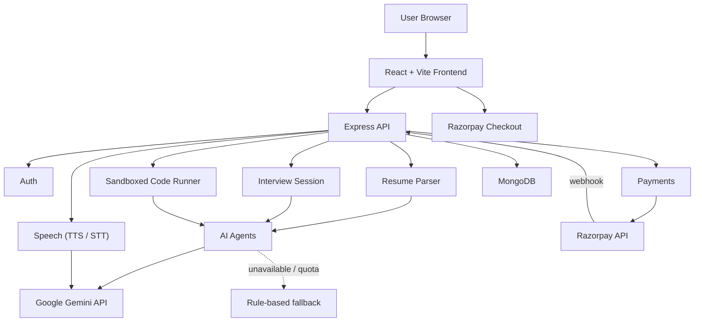

# InterviewIQ — AI Mock Interview Platform

> Upload your resume, get Gemini-powered resume feedback, and practice realistic, adaptive voice interviews with a live coding round, detailed scoring, and a personalized improvement roadmap.


---

## Table of Contents

- [Overview](#overview)
- [Key Features](#key-features)
- [Tech Stack](#tech-stack)
- [Getting Started](#getting-started)
- [Available Scripts](#available-scripts)
- [Project Structure](#project-structure)
- [System Architecture](#system-architecture)
- [How Gemini Is Used](#how-gemini-is-used)
- [Interview Flow](#interview-flow)
- [Scoring](#scoring)
- [Payments](#payments)
- [API Overview](#api-overview)
- [Data Model](#data-model)
- [Environment Variables](#environment-variables)
- [Security](#security)
- [Deployment](#deployment)
- [Troubleshooting](#troubleshooting)
- [Roadmap](#roadmap)
- [License](#license)
- [Author](#author)

---

## Overview

**InterviewIQ** is an AI-powered mock interview platform for students, freshers, and working professionals. Instead of generic question banks, it reads your resume, builds a candidate profile, and conducts an interview tailored to your skills, projects, experience, and target role, then scores every answer and gives you a plan to improve.

**Who it's for**

- Students preparing for campus placements
- Freshers applying for entry-level jobs
- Professionals switching roles
- Training institutes that need scalable interview practice

---

## Key Features

| Feature | Description |
|---|---|
| **Resume analysis** | Upload a PDF, DOC, or DOCX. Gemini extracts skills, projects, experience, education, strengths, and gaps, scores the resume out of 100, and gives prioritized improvement suggestions |
| **Adaptive interviews** | One question at a time, grounded in your actual projects and skills. Shallow answers get a follow-up, strong answers go deeper, and questions never repeat |
| **Voice mode** | Gemini text-to-speech reads each question aloud. Your recorded answers are transcribed by Gemini, keeping filler words for communication analysis. Falls back to browser speech automatically |
| **Coding round** | One problem per interview in a Monaco editor. JavaScript solutions run against hidden tests in a sandbox; every language gets an AI code review |
| **Detailed reports** | Overall, technical, behavioral, communication, and coding scores, plus a question-by-question analysis with feedback and a stronger example answer for each |
| **Personalized roadmap** | Prioritized learning actions with estimated timelines |
| **Dashboard & analytics** | Progress-over-time charts, skill radar, communication metrics, and interview history |
| **Auth** | Email/password (JWT) and optional Google sign-in |
| **Free + paid usage** | 2 free interviews, then per-interview credits bought through Razorpay (UPI, cards, netbanking, wallets) |

---

## Tech Stack

### Frontend (`src/`)

| Area | Technology |
|---|---|
| Framework | React 19 |
| Build tool | Vite 7 |
| Routing | React Router 7 |
| Styling | Tailwind CSS 3.4 |
| UI | `lucide-react` icons, Framer Motion, `clsx` + `tailwind-merge` |
| Charts | Recharts |
| Code editor | Monaco Editor (`@monaco-editor/react`) |
| Voice | MediaRecorder + Web Audio (recording, WAV conversion), Web Speech API (fallback) |
| Payments | Razorpay Checkout |

### Backend (`server/`)

| Area | Technology |
|---|---|
| Runtime / API | Node.js, Express 5 (REST) |
| Database | MongoDB with Mongoose (Atlas via `MONGODB_URI`, or an embedded MongoDB for zero-setup local development) |
| Auth | bcrypt password hashing, JWT, Google ID-token verification |
| AI | Google Gemini for analysis, question generation, evaluation, and reports; a built-in rule-based engine when Gemini is unavailable |
| Speech | Gemini text-to-speech and speech-to-text |
| Resume parsing | `pdf-parse` (PDF), `mammoth` (DOCX), best-effort text extraction for legacy DOC |
| Code execution | Separate Node.js process with the permission model (no file system or child-process access), 4-second timeout, 64 MB memory cap |
| Payments | Razorpay Orders API, HMAC signature verification, webhooks |
| Validation / security | Zod, Helmet, CORS, express-rate-limit |

---

## Getting Started

### Prerequisites

- **Node.js 20.19+**
- **npm**
- A **Gemini API key** from [Google AI Studio](https://aistudio.google.com/apikey) (optional: without one, the rule-based engine runs)
- **Razorpay test keys** from the [Razorpay Dashboard](https://dashboard.razorpay.com/app/keys) (optional: without them, payments run in demo mode)

### Installation

```bash
# 1. Clone the repository
git clone https://github.com/CodewithGuptaShubh/InterviewIQ.git
cd InterviewIQ

# 2. Install frontend and backend dependencies
npm run setup

# 3. Create your backend config and fill in your keys
cp server/.env.example server/.env

# 4. (Optional) load demo data: account demo@interviewiq.app / demo12345 with 3 past interviews
npm run seed

# 5. Start the database, API (port 8080), and frontend (port 5173) together
npm run dev:all
```

Open `http://localhost:5173`, create an account, upload a resume, and start an interview. Vite proxies `/api` to the backend, so the frontend needs no configuration locally.

With `MONGODB_URI` empty, an embedded MongoDB stores data in `server/.data/` (the MongoDB binary, about 800 MB, is downloaded once on first start). Visit `http://localhost:8080/api/health` to see the database status and which AI, speech, and payment providers are active.

Stop everything with **Ctrl+C** in the terminal running `npm run dev:all`.

---

## Available Scripts

| Command | What it does |
|---|---|
| `npm run setup` | Installs frontend and backend dependencies |
| `npm run dev:all` | Runs the database, API, and frontend together |
| `npm run server` | Runs only the database and API, restarting the API on file changes |
| `npm run dev` | Runs only the frontend dev server |
| `npm run seed` | Resets and loads the demo account (safe to run while the app is running) |
| `npm --prefix server test` | Runs the backend unit tests |
| `npm run build` | Creates a production build of the frontend in `dist/` |
| `npm run preview` | Serves the production build locally |

---

## Project Structure

```
InterviewIQ/
├── src/                              # React frontend
│   ├── api/client.js                 # fetch wrapper and all API calls
│   ├── state/AppContext.jsx          # user, profile, analytics, history
│   ├── hooks/useSpeech.js            # recording, transcription, and spoken questions
│   ├── lib/                          # audio (WAV conversion), Razorpay checkout, utilities
│   ├── components/                   # UI primitives, app shell, Google sign-in button
│   └── pages/                        # Dashboard, Resume, Interview, Analytics, Report, Pricing, Profile, Login, Signup
├── server/                           # Express backend
│   ├── src/
│   │   ├── index.js, app.js          # startup, middleware, routes
│   │   ├── devDb.js                  # standalone embedded MongoDB for local development
│   │   ├── seed.js                   # demo data
│   │   ├── config/                   # environment settings, database connection
│   │   ├── models/                   # User, Resume, CandidateProfile, Interview, InterviewTurn,
│   │   │                             # CodingSubmission, Report, Payment
│   │   ├── routes/                   # auth, resumes, profiles, interviews, reports, payments, speech
│   │   ├── services/
│   │   │   ├── agents/               # resume, strategy, interviewer, communication, coding, evaluation
│   │   │   ├── interviewSession.js   # quota, round progression, completion
│   │   │   ├── llm.js                # Gemini calls, quota handling, fallback
│   │   │   ├── speech.js             # Gemini text-to-speech and speech-to-text
│   │   │   ├── razorpay.js           # orders and signature verification
│   │   │   ├── codeRunner.js         # sandboxed JavaScript test runner
│   │   │   └── resumeParser.js       # PDF/DOCX/DOC text extraction and file checks
│   │   ├── data/                     # coding problems, question bank, skill dictionary
│   │   └── utils/                    # response serializers, HTTP helpers
│   ├── test/                         # unit tests (node:test)
│   └── .env.example                  # template for server/.env
├── InterviewIQ-Implementation-Blueprint.md
└── vite.config.js                    # proxies /api to http://localhost:8080
```

---

## System Architecture



---

## How Gemini Is Used

| Step | What Gemini does | Code |
|---|---|---|
| Resume analysis | Extracts the candidate profile, scores the resume, and writes improvement suggestions and project-specific question ideas | `agents/resumeAgent.js` |
| Question generation | Writes each question from the resume, the conversation so far, and the current round | `agents/interviewerAgent.js` |
| Answer analysis | Scores each answer (correctness, depth, clarity, confidence) and decides whether to follow up, in the same call as the next question | `agents/interviewerAgent.js` |
| Code review | Rates logic, efficiency, and readability and estimates complexity | `agents/codingAgent.js` |
| Final report | Technical and behavioral scores, strengths, weaknesses, roadmap, summary, and per-question feedback | `agents/evaluationAgent.js` |
| Speech | Reads questions aloud and transcribes recorded answers | `services/speech.js` |

**Not done by Gemini:** coding tests actually execute on the server, communication metrics (filler words, pace, structure) are computed in code, and the overall score uses a fixed formula.

**Reliability:** if a Gemini call fails or a model's daily quota runs out, that step falls back to the rule-based engine and the model is skipped until its quota resets, so an interview never stops. Transcription uses a separate lite model with its own quota. Gemini 3 models are called with a low thinking level to keep responses fast (a few seconds instead of a minute).

---

## Interview Flow

1. **Upload your resume** and review the profile, resume score, and suggestions
2. **Start the interview.** The difficulty (beginner, intermediate, or advanced) comes from your resume
3. **Conversational rounds:** Introduction → Resume → Technical → Project → Behavioral → Stress (advanced only) → Closing
4. **Coding round:** solve one problem in the editor at any point during the interview
5. **End the interview** to generate the report, which appears on your dashboard

---

## Scoring

```
overallScore =
  technicalScore     * 0.35 +
  communicationScore * 0.20 +
  codingScore        * 0.20 +
  behavioralScore    * 0.15 +
  consistencyScore   * 0.10
```

| Score | Band |
|---|---|
| 0–39 | Weak |
| 40–59 | Needs improvement |
| 60–74 | Acceptable |
| 75–89 | Strong |
| 90–100 | Excellent |

Reports also include a hiring-readiness score, placement readiness, per-skill technical scores, behavioral scores (teamwork, leadership, problem solving, ownership), and coding scores (logic, efficiency, correctness, readability).

---

## Payments

Payments use Razorpay when `RAZORPAY_KEY_ID` and `RAZORPAY_KEY_SECRET` are set, and a demo mode (credits added without charging) when they aren't.

1. The server creates the Razorpay order, so the amount can't be changed in the browser
2. The user pays in Razorpay Checkout
3. The server verifies Razorpay's HMAC signature before adding any credits
4. Each order credits exactly once, even if both the browser and the webhook report it
5. The optional webhook (`payment.captured`, `payment.failed`) credits orders even if the browser closes right after paying

**Usage rules:** free interviews are used first, then paid credits.

```
canStartInterview(user):
  if freeInterviewsUsed < 2    → use a free interview
  else if user.credits > 0     → use 1 paid credit
  else                         → require payment
```

---

## API Overview

All routes are prefixed with `/api`.

<details>
<summary><b>Auth</b></summary>

| Method | Endpoint | Auth | Description |
|---|---|---|---|
| POST | `/auth/signup` | No | Create an email/password account |
| POST | `/auth/login` | No | Log in and return a JWT |
| POST | `/auth/google` | No | Exchange a Google ID token for a JWT |
| GET | `/auth/me` | Yes | Current user |
| PATCH | `/auth/me` | Yes | Update name, email, title, preferences |
| POST | `/auth/logout` | Yes | Log out (the client discards the JWT) |

</details>

<details>
<summary><b>Resume & Profile</b></summary>

| Method | Endpoint | Auth | Description |
|---|---|---|---|
| POST | `/resumes` | Yes | Upload (multipart field `resume`, max 5 MB), parse, and analyze in one call |
| POST | `/resumes/:id/analyze` | Yes | Re-analyze a stored resume, optionally for a new `targetRole` |
| GET | `/resumes` | Yes | Uploaded resumes |
| GET | `/profiles/me` | Yes | Latest candidate profile |
| PATCH | `/profiles/me` | Yes | Update target role or difficulty |

</details>

<details>
<summary><b>Interviews & Coding</b></summary>

| Method | Endpoint | Auth | Description |
|---|---|---|---|
| POST | `/interviews` | Yes | Use quota, create and start an interview, return the first question |
| GET | `/interviews` | Yes | Interview history |
| GET | `/interviews/active` | Yes | The in-progress interview, if any |
| GET | `/interviews/:id` | Yes | Interview details and transcript |
| POST | `/interviews/:id/turns` | Yes | Submit `{ answer, durationSeconds? }` and get the next question |
| POST | `/interviews/:id/complete` | Yes | Complete the interview and generate the report |
| POST | `/interviews/:id/cancel` | Yes | Abandon an interview |
| GET | `/interviews/:id/coding-question` | Yes | The assigned coding problem |
| POST | `/interviews/:id/coding-submission` | Yes | Run tests (JavaScript) and review the solution |

</details>

<details>
<summary><b>Reports, Speech & Payments</b></summary>

| Method | Endpoint | Auth | Description |
|---|---|---|---|
| GET | `/reports/:interviewId` | Yes | Final report |
| GET | `/reports/analytics/summary` | Yes | Dashboard metrics |
| POST | `/speech/tts` | Yes | Gemini text-to-speech, returns `audio/wav` |
| POST | `/speech/stt` | Yes | Gemini speech-to-text (multipart field `audio`) |
| GET | `/payments/config` | Yes | Payment provider and public Razorpay key |
| POST | `/payments/create-order` | Yes | Create an order (amount set on the server) |
| POST | `/payments/verify` | Yes | Verify the Razorpay signature and add credits |
| POST | `/payments/failed` | Yes | Record a failed checkout attempt |
| POST | `/payments/webhook` | Signature | Razorpay webhook |
| GET | `/payments/history` | Yes | Payment history |
| GET | `/health` | No | Database status and active AI, speech, and payment providers |

</details>

---

## Data Model

MongoDB collections:

`users` · `candidateprofiles` · `resumes` · `interviews` · `interviewturns` · `codingsubmissions` · `reports` · `payments`

- A user has many resumes, interviews, and payments; quota counters (`credits`, `freeInterviewsUsed`) live on the user
- Each resume upload creates a new candidate profile; the latest one is used for interviews
- An interview has many turns, one coding submission, and one report

---

## Environment Variables

### Backend (`server/.env`)

Copy `server/.env.example` to `server/.env` and fill in your values. Every setting is optional for local development.

```env
NODE_ENV=development
PORT=8080
CLIENT_URL=http://localhost:5173        # allowed frontend origins in production (comma-separated)
MONGODB_URI=                            # empty → embedded MongoDB in server/.data
JWT_ACCESS_SECRET=                      # long random string; required in production
JWT_EXPIRES_IN=7d
GOOGLE_CLIENT_ID=                       # enables Google sign-in

GEMINI_API_KEY=                         # empty → rule-based engine
GEMINI_MODEL=gemini-3.5-flash
GEMINI_THINKING_LEVEL=low               # low | medium | high (higher is slower)
GEMINI_STT_MODEL=gemini-3.1-flash-lite  # transcription model, with its own quota
GEMINI_TTS_MODEL=gemini-3.8-flash-tts
GEMINI_TTS_VOICE=Kore

INTERVIEW_PRICE_INR=50
FREE_INTERVIEW_LIMIT=2
RAZORPAY_KEY_ID=                        # empty → demo payments
RAZORPAY_KEY_SECRET=
RAZORPAY_WEBHOOK_SECRET=                # optional
```

### Frontend

Both optional for local development.

```env
VITE_API_URL=            # backend URL for deployed builds (local development uses the Vite proxy)
VITE_GOOGLE_CLIENT_ID=   # shows the Google sign-in button
```

> `server/.env` is excluded by `.gitignore`. Never commit it or put real keys in `.env.example`.

---

## Security

- Passwords hashed with bcrypt; JWT sessions (7 days by default)
- Request validation with Zod; Helmet headers; CORS restricted to `CLIENT_URL` in production
- Rate limiting on auth, upload, interview, speech, and payment routes
- Resume uploads checked by file signature (magic bytes) with a 5 MB limit
- Gemini and Razorpay secret keys stay on the server; the browser only receives the public Razorpay key ID
- Payments credited only after server-side HMAC signature verification; webhooks verified the same way
- User code runs in a separate process with the Node.js permission model, a timeout, and a memory cap, never inside the API process

---

## Deployment

| Layer | Suggested host | Notes |
|---|---|---|
| Frontend | Vercel or Netlify | Build with `npm run build`; set `VITE_API_URL` to the API URL |
| Backend | Render or Railway | Root directory `server`, start command `npm start`; set the variables from `server/.env.example` |
| Database | MongoDB Atlas | Set `MONGODB_URI`; the embedded database is for local development only |

In production also set `NODE_ENV=production`, a strong `JWT_ACCESS_SECRET`, `CLIENT_URL` to the frontend URL, Razorpay live keys, and the webhook URL `https://<api>/api/payments/webhook` in the Razorpay Dashboard.

**Gemini quota:** on the free tier each model allows about 20 requests per day, and one full interview uses roughly 30 across the text, transcription, and voice models. Enable billing in Google AI Studio before a demo or launch.

---

## Troubleshooting

| Problem | Fix |
|---|---|
| `Port 5173/8080 is already in use` | Another copy is running. Stop it with Ctrl+C in its terminal (closing the terminal window may leave it running) |
| `Missing script: "dev:all"` | Use a colon: `npm run dev:all` |
| Answers look generic or the voice sounds robotic | Gemini is unavailable or out of quota and the fallback is running; check the server terminal for `[gemini]` lines |
| Payment succeeded but no credit appeared | Check the payment history on the Pricing page; set up the webhook so payments credit even if the browser closes |

---

## Roadmap

- [x] Auth, protected routes, and app shell
- [x] Resume upload, parsing, analysis, and suggestions
- [x] Adaptive interview engine with round progression
- [x] Voice interviews with Gemini text-to-speech and speech-to-text
- [x] Coding round with sandboxed tests and AI review
- [x] Reports, question-by-question analysis, and analytics dashboard
- [x] Quotas, credits, and Razorpay payments
- [ ] Real-time interviews over WebSockets
- [ ] Code execution for Python, Java, C++, and C
- [ ] Resume file storage (Cloudinary or S3)
- [ ] Deployment, monitoring, and refresh-token rotation

---

## License

No license file is included yet. Add one (for example MIT) to define how others may use this project.

---

## Author

**Shubh Gupta** — [@CodewithGuptaShubh](https://github.com/CodewithGuptaShubh)
